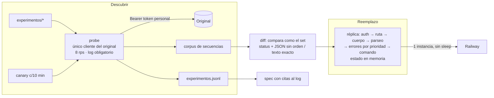

# Réplica conforme de la caja negra

**Reto:** 2 · **Autor:** Juan Pablo Rios · **10 oct 2026**

## Qué resuelve

Un reemplazo **determinista** que devuelve el mismo status y el mismo cuerpo que el original en cada
request de un test (auth, rutas, `POST /msg`, `__reset`), con la versión vigente a las 20:00. Su
límite es lo que el set compara: status + cuerpo. El método es experimental: cada regla de la réplica
sale de un request registrado en el log, y la spec cita esa línea.

## Supuestos

- **El servicio es determinista salvo por su estado** (contadores `AC-`/`OP-`, saldos). Por qué: los
  20 ejemplos son reproducibles tras un reset. Se verifica repitiendo secuencias.
- **El control es mod 97 estilo IBAN**: letras A=1…Z=26, dígitos tal cual, se descartan `;` y `-`,
  `98 − (N·100 mod 97)`. Por qué: encaja con los 17 ejemplos que tienen control, sin un solo request.
  Queda *probable* hasta confirmarlo en el original.
- **El set solo usa el token del equipo.** Con cualquier otro token se responde lo que el original
  responde a un token desconocido. Esto se mide.
- **El incidente de las 15:30 cambia reglas, no el protocolo.**

## Qué queda fuera, y por qué

- **Headers** (incluido `X-Req`): el set no los compara. Se registran en el log, pero no se replican.
- **Rate limit** (`X-Frontier-Infra`): es de la infraestructura, no del servicio.
- **Persistencia y escala:** el set hace reset antes de cada test y habla con un solo proceso.
- **LLM dentro de la réplica:** no es determinista, suma latencia y cuesta dinero; aquí no aporta nada.
- **Blockchain para el log:** git ya da un historial verificable, sin costo ni latencia.

## Casos difíciles

| Caso | Riesgo | Cómo lo manejo |
|---|---|---|
| Precedencia de errores | Un request con dos fallas: ¿cuál gana? | Matriz de experimentos con fallas combinadas; tabla de errores con prioridad explícita |
| Secuencias largas (6–12) | Un ID o saldo mal calculado tumba la secuencia entera | Corpus de secuencias grabadas; diff paso a paso |
| Cuerpos raros | No-JSON, `m` ausente o de otro tipo; el texto se compara carácter por carácter | Fuzzer propio de cuerpos; se guarda el cuerpo crudo |
| Rutas y métodos inexistentes | El 40% son tests de un solo request | Barrido de método × ruta × auth |
| Incidente de las 15:30 | El original cambia y la réplica queda vieja | *Canary*: re-graba secuencias fijas cada 10 min y avisa si hay diferencias |
| Cupo de 8.000 requests | Agotarlo antes del incidente | Unos 5.000 antes de las 15:30 y 2.500 de reserva; cliente limitado a 8 rps |

## Arquitectura

| Componente | Responsabilidad | Por qué existe |
|---|---|---|
| `probe` | Única puerta al original; reset por secuencia; registra todo | El log es entregable: nada sale sin registro |
| `diff` | Reproduce el corpus contra la réplica y mide igual que el set | Solo hay 3 corridas oficiales |
| `réplica` | Pipeline de validación + reglas declarativas | El incidente exige cambiar reglas en minutos |
| `canary` | Detecta cambios en el original | El criterio "respuesta al incidente" premia detectarlo |

## Decisiones y alternativas descartadas

| Decisión | Alternativa descartada | Por qué |
|---|---|---|
| Tabla de errores con prioridad explícita | `if` dispersos por comando | La precedencia se mide y cambia con el incidente; los datos se cambian más rápido que el código |
| Estado en memoria, 1 proceso | Base de datos | Hay reset antes de cada test y un solo cliente: una DB solo suma latencia y fallas |
| Railway, 1 réplica siempre encendida | Serverless o túnel local | Serverless pierde el estado entre instancias; un túnel se cae en el debrief y deja el set en 0 |
| Node 24 con TypeScript nativo (sin build) | `tsc` o bundler | Tipos sin paso de compilación; menos piezas que se rompan |
| Inferir el control *offline* con los ejemplos | Barrer 0–99 en el original | Ahorra cientos de requests; se confirma con unos 5 |
| Arnés `diff` propio como métrica principal | Depurar con las validaciones oficiales | Solo hay 3; se reservan para 14:30, 18:00 y 19:30 |

## Cómo mido que funciona

| Métrica | Objetivo | Cómo |
|---|---|---|
| Coincidencia en el `diff`, por tamaño de test (1 / 2–5 / 6–12) | ≥ 90% en cada uno (la nota 4 exige > 75%) | Corpus propio grabado del original |
| 20 ejemplos oficiales | 100% | Test fijo en cada cambio |
| Afirmaciones de la spec | 0 falsas; *confirmado* solo con ≥ 2 observaciones | Cada fila cita IDs del log |
| Latencia de la réplica | p99 < 500 ms (el límite es 5 s) | El `diff` contra el despliegue |
| Detección del incidente | < 10 min | Alerta del `canary` con su diff guardado |

**Cómo sabría que está fallando:** el `canary` muestra diferencias contra la grabación; la réplica
responde con un comportamiento marcado como *supuesto* (lo cuento por request); `/health` deja de
dar 200; la tasa de coincidencia del `diff` contra el despliegue es menor que la local.
