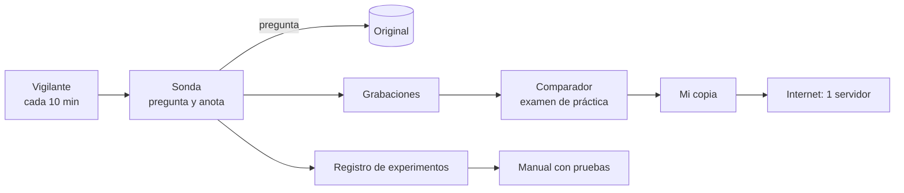

# Réplica de la caja negra — diseño

**Reto 2** · Juan Pablo Rios · 10 de octubre de 2026

## El problema, en simple

Un servicio heredado recibe mensajes de texto por HTTP y responde. No hay código ni documentación.
Por lo que muestran los ejemplos, es un **banco de juguete**: crea cuentas (`ALTA`), recibe depósitos
(`DEPOSITO`), transfiere (`TRANSFER`), consulta saldos (`CONSULTA`) y anula operaciones (`ANULA`).
Cada mensaje termina en un **dígito de control** que detecta errores de escritura, como el último
dígito de una tarjeta de crédito.

**Qué construyo:** una copia que responda **exactamente igual**: el mismo código HTTP y el mismo
texto, errores raros incluidos (por ejemplo `"recieved"`, mal escrito a propósito). Se califica con
100 pruebas que comparan mis respuestas con las del original.

## Cómo lo resuelvo: método de detective

No adivino: **experimento**. Cada pregunta al original se registra con la hipótesis que estaba
probando y lo que aprendí. Cada regla de mi copia sale de un experimento registrado, y el manual
(la especificación) cita esa línea como prueba.

## Lo que asumo (y cómo lo voy a verificar)

| Supuesto | Por qué lo creo | Cómo lo confirmo |
|---|---|---|
| Ante el mismo mensaje y el mismo estado, responde siempre igual (es **determinista**) | Los ejemplos se reproducen tras un reinicio | Repito secuencias y comparo |
| El dígito de control se calcula como en el IBAN (bancos europeos), con módulo 97 | Mi fórmula acierta en los 17 ejemplos que tienen control, sin gastar un solo intento | Unos 5 mensajes nuevos al original |
| Las pruebas oficiales usan solo el token del equipo | Lo dice el contrato | Mido qué responde el original con tokens inválidos |
| El cambio anunciado para las 15:30 cambia reglas, no la forma de comunicarse | Es lo más probable en un "incidente" | El vigilante (*canary*) lo detecta |

## Lo que dejo fuera, a propósito

- **Las cabeceras HTTP:** las pruebas no las comparan; replicarlas sería esfuerzo sin retorno.
- **Base de datos:** las pruebas reinician el estado antes de cada test, así que basta con la memoria.
- **Inteligencia artificial dentro de la copia:** un modelo puede responder distinto cada vez; un
  banco que debe ser idéntico necesita reglas fijas.
- **Blockchain para el registro:** git ya guarda un historial verificable, gratis.

## Dónde se puede romper

| Caso difícil | Por qué es difícil | Qué hago |
|---|---|---|
| Un mensaje con dos errores a la vez | Hay que saber cuál reporta primero (la **precedencia**) | Experimentos que combinan errores, de dos en dos |
| Secuencias largas (6 a 12 mensajes) | Un número de cuenta o un saldo mal calculado arruina toda la secuencia | Grabo secuencias reales y las comparo paso a paso |
| Mensajes basura (vacíos, sin formato, rutas que no existen) | El 40% de las pruebas son de un solo mensaje | Pruebas automáticas con entradas raras (**fuzzing**) |
| El cambio de las 15:30 | Mi copia queda desactualizada | Vigilancia cada 10 minutos |
| Solo 8.000 preguntas al día al original | Gastarlas antes del cambio | 5.000 antes de las 15:30 y 2.500 de reserva |

## Las 4 piezas

| Pieza | Qué hace | Por qué existe |
|---|---|---|
| **Sonda** (*probe*) | Única forma de hablarle al original; anota todo | El registro es un entregable: nada puede quedar sin anotar |
| **Mi copia** (*réplica*) | Responde como el original, con reglas en tablas | Si las reglas cambian a las 15:30, se edita una tabla, no todo el código |
| **Comparador** (*diff*) | Repite lo grabado contra mi copia y mide el acierto | Solo hay 3 calificaciones oficiales en el día |
| **Vigilante** (*canary*) | Repite preguntas fijas y avisa si algo cambió | Detectar el cambio rápido es parte de la nota |

## Decisiones: qué elegí y qué descarté

| Elegí | Descarté | Por qué |
|---|---|---|
| Reglas de error en una tabla con orden de prioridad | Condiciones repartidas por el código | Es más fácil de corregir cuando el original cambia |
| Estado en memoria, un solo servidor | Base de datos | Las pruebas reinician todo y hablan con un solo servidor |
| Servidor siempre encendido en la nube (Railway) | Mi computador con un túnel, o "serverless" | Un túnel se cae en el peor momento; *serverless* pierde la memoria |
| Deducir el dígito de control con matemáticas sobre los ejemplos | Probar del 0 al 99 contra el original | Ahorra cientos de preguntas del cupo diario |
| Medir con mi comparador | Usar las 3 calificaciones oficiales para depurar | Las guardo para las 14:30, las 18:00 y las 19:30 |

## Cómo sé que funciona

| Qué mido | Meta | Cómo |
|---|---|---|
| Acierto del comparador, por largo de la prueba (1 / 2–5 / 6–12 mensajes) | ≥ 90% (la nota máxima pide más de 75%) | Grabaciones reales del original |
| Los 20 ejemplos oficiales | 100% | Prueba fija tras cada cambio |
| Afirmaciones falsas en el manual | 0; algo es "confirmado" solo si lo vi 2 veces | Cada regla cita su experimento |
| Tiempo de respuesta | < 0,5 s (el límite es 5 s) | El comparador contra el servidor en internet |
| Detección del cambio de las 15:30 | < 10 minutos | Alerta del vigilante |

**Señales de que algo falla:** el vigilante encuentra diferencias; mi copia responde algo que marqué
como "supuesto"; el servidor deja de responder; el acierto en internet es menor que en mi máquina.
